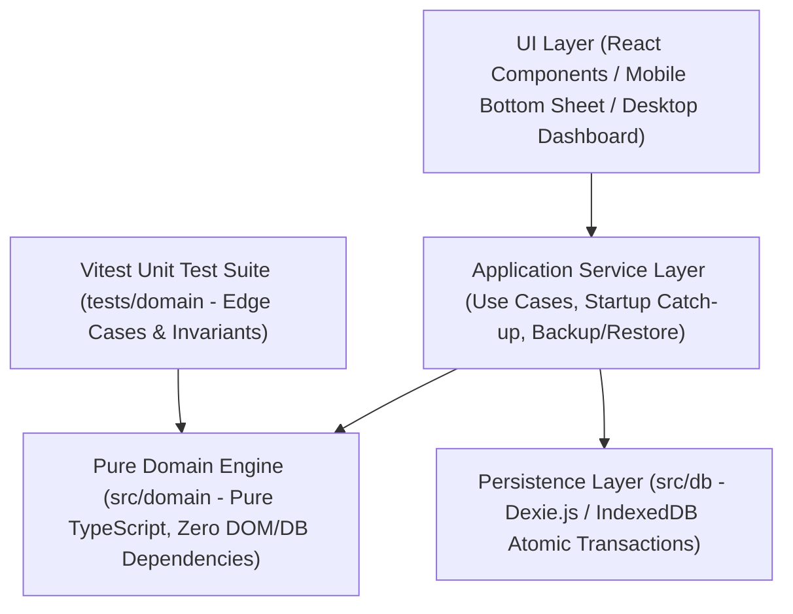

# 個人多帳戶記帳軟體（PWA）— 系統架構與工程設計文件

> **技術棧**：React + TypeScript + Vite + Tailwind CSS + Dexie.js (IndexedDB) + Vitest  
> **架構核心**：純前端本機優先（Local-first）、Domain Logic 與 UI/DB 完全解耦、以最小貨幣單位整數與本地日曆日期確保帳務精確性。

---

## 1. 系統分層與目錄結構

### 1.1 分層架構圖



### 1.2 設計邊界原則

1. **Domain Layer 零副作用**：`src/domain/` 內所有函式皆為純函式（Pure Functions），不依賴 `window`、`IndexedDB`、系統時區或 `new Date()`（所有「今日日期」皆由呼叫端作為參數 `asOfDate: ISODate` 傳入），確保 Vitest 測試 100% 可重現。
2. **交易原子性（Atomicity）**：任何涉及多筆寫入的操作（如：建立分期付款寫入 `installmentPlans` + N 筆 `transactions`、轉帳、週期補發）必須包在 `db.transaction('rw', ...)` 內，失敗則全部回滾。
3. **即時投影計算（Derived State）**：帳戶餘額、信用卡當期應繳金額、分類預算進度皆由 `initialBalance + 歷史有效交易` 即時推導計算（配合 React memoization 與 Dexie `useLiveQuery`），徹底消滅「修改三個月前帳務後餘額不同步」的狀態漂移問題。

### 1.3 建議目錄結構

```text
src/
├── domain/                    # 純邏輯核心（Vitest 主戰場）
│   ├── types.ts               # 核心型別（Money, ISODate, Entities）
│   ├── money.ts               # 整數金額運算、分期拆帳、格式化
│   ├── date.ts                # 本地日曆日期運算、Anchor Day 月份推算
│   ├── ledger.ts              # 帳戶餘額、淨資產、收支統計計算
│   ├── creditCardCycle.ts     # 信用卡結帳日 / 繳款日 / 帳單狀態計算機
│   ├── installment.ts         # 分期展開與異動策略引擎
│   ├── recurring.ts           # 週期性帳務冪等補發引擎
│   └── budget.ts              # 分類預算與警示計算
├── db/                        # IndexedDB 存取層
│   ├── database.ts            # Dexie Schema 與索引定義
│   ├── repositories/          # 各表原子操作封裝
│   └── backup.ts              # JSON 匯出匯入與 Schema 校驗
├── services/                  # Application Use Cases
│   ├── startupService.ts      # 啟動時執行週期補發、種子資料初始化
│   └── transactionService.ts  # 串接 Domain 驗證與 DB 原子寫入
├── features/                  # UI 功能模組（雙棲自適應介面）
│   ├── quickEntry/            # 手機 Bottom Sheet / 桌機 Modal 快速記帳
│   ├── dashboard/             # 淨資產總覽、預算進度、近期帳務
│   ├── accounts/              # 帳戶管理、信用卡帳單明細與繳款精靈
│   ├── recurring/             # 固定收支規則管理
│   └── settings/              # JSON 備份還原、分類管理
└── tests/
    └── domain/                # 對應 domain/ 各模組的單元測試
```

---

## 2. 核心不變量（Core Invariants）

在寫任何程式碼前，整個系統必須嚴格遵守以下四條規則：

### 2.1 金額表示法：`Money`（整數最小單位）
* 嚴禁在運算過程使用浮點數（避免 `0.1 + 0.2 = 0.30000000000000004`）。
* 所有交易金額、帳戶餘額、預算上限統一使用**整數**儲存，單位為「最小貨幣單位」（預設以台幣為例可設 `scale = 100`，即 `100 = NT$1.00`，或純整數台幣 `scale = 1`；**本架構採用 `scale = 100` 的 `MinorUnits`**，以同時相容未來外幣小數或銀行零頭利息）。
* `Transaction.amount` 恆為**正整數（`> 0`）**，資金流向完全由 `Transaction.type`（`expense` / `income` / `transfer`）決定，避免正負號混用導致邏輯錯亂。

### 2.2 日期表示法：`ISODate`（`YYYY-MM-DD`）
* 帳務歸屬日期（`transactionDate`、`startDate`、`recurringOccurrenceDate`）一律使用無時區的本地日曆字串 `YYYY-MM-DD`。
* **原因**：若存成 UTC Timestamp，台灣時間（`UTC+8`）半夜 `00:30` 的消費在 UTC 會變成前一天，導致月底結帳日與月報表跨日錯位。
* `createdAt` 與 `updatedAt` 則使用 Unix Epoch Milliseconds（`number`），僅用於排序與審計追蹤。

### 2.3 帳戶餘額與負債符號一致化
* **資產帳戶**（`cash`、`bank`、`ewallet`）與**負債帳戶**（`credit_card`）採用同一套符號規則：
  * 資金流入（`income` 或 `transfer.toAccountId`）：`+amount`
  * 資金流出（`expense` 或 `transfer.fromAccountId`）：`-amount`
* 因此，信用卡刷卡消費 NT$500 時，該卡餘額變為 `-50000`（代表負債 500 元）；銀行轉帳 500 元繳卡費時，銀行 `-50000`、信用卡 `+50000` 回到 `0`。
* **好處**：`總淨資產 = 所有未封存帳戶餘額的直接加總`，不需要在各處寫 `if (type === 'credit_card')` 特判減法。UI 顯示信用卡時再取 `-balance` 顯示「目前欠款 / 已用額度」。

### 2.4 轉帳與繳卡費不污染收支報表
* **支出（Expense）**：僅統計 `type === 'expense'` 且 `status === 'posted'` 的交易。
* **收入（Income）**：僅統計 `type === 'income'` 且 `status === 'posted'` 的交易。
* **轉帳（Transfer）**（包含現金提款、帳戶調撥、**繳交信用卡費**）：只改變兩個帳戶的餘額，**絕不計入月支出、月收入與預算消耗**（消費行為在「刷卡當下」就已經計入該分類支出與預算）。

---

## 3. Dexie.js (IndexedDB) 資料表 Schema 設計

所有主鍵統一採用 **UUID v4 字串**（`string`），避免本機 `++id` 自增主鍵在 JSON 匯出/匯入還原或跨裝置合併時發生 ID 衝突。

### 3.1 資料表與索引定義

```typescript
// src/db/database.ts
import Dexie, { type EntityTable } from 'dexie';
import type {
  Account,
  Category,
  Transaction,
  InstallmentPlan,
  RecurringRule,
  Budget,
  AppMeta,
} from '../domain/types';

export class LedgerDatabase extends Dexie {
  accounts!: EntityTable<Account, 'id'>;
  categories!: EntityTable<Category, 'id'>;
  transactions!: EntityTable<Transaction, 'id'>;
  installmentPlans!: EntityTable<InstallmentPlan, 'id'>;
  recurringRules!: EntityTable<RecurringRule, 'id'>;
  budgets!: EntityTable<Budget, 'id'>;
  appMeta!: EntityTable<AppMeta, 'key'>;

  constructor() {
    super('PersonalLedgerDB');

    this.version(1).stores({
      accounts: 'id, type, isArchived, sortOrder',
      categories: 'id, type, isArchived, sortOrder',
      // 複合索引說明：
      // [accountId+transactionDate]：快速查詢單一帳戶特定帳期明細
      // [recurringRuleId+recurringOccurrenceDate]：週期補發冪等性檢查
      // [status+transactionDate]：儀表板與報表區間查詢
      transactions: [
        'id',
        'transactionDate',
        'accountId',
        'toAccountId',
        'categoryId',
        'type',
        'status',
        'installmentPlanId',
        'recurringRuleId',
        '[accountId+transactionDate]',
        '[status+transactionDate]',
        '[recurringRuleId+recurringOccurrenceDate]',
      ].join(', '),
      installmentPlans: 'id, accountId, status, startDate',
      recurringRules: 'id, isActive, frequency, nextRunDate',
      budgets: 'id, categoryId, yearMonth, [categoryId+yearMonth]',
      appMeta: 'key',
    });
  }
}
```

### 3.2 核心 Entity 型別定義（`src/domain/types.ts`）

```typescript
/** 以最小貨幣單位表示的整數金額（例如 scale=100 時，10000 代表 100.00 元） */
export type MinorUnits = number;

/** 本地日曆日期格式：YYYY-MM-DD */
export type ISODate = string;

/** 年月格式：YYYY-MM */
export type YearMonth = string;

export type AccountType = 'cash' | 'bank' | 'ewallet' | 'credit_card';

export interface CreditCardConfig {
  /** 每月結帳日（1-31）；若當月天數不足則自動對齊月底（如 31 號在 2 月為 28/29 號） */
  statementDay: number;
  /** 每月繳款截止日（1-31） */
  paymentDueDay: number;
  /**
   * 繳款日相對於結帳日的月份偏移量：
   * - 0: 同月繳款（例如 5 號結帳、25 號繳款）
   * - 1: 次月繳款（例如 15 號結帳、次月 3 號繳款）
   */
  paymentDueMonthOffset: 0 | 1;
  /** 信用額度（選填，MinorUnits） */
  creditLimit?: MinorUnits;
}

export interface Account {
  id: string;
  name: string;
  type: AccountType;
  currency: string; // e.g. 'TWD'
  /** 開帳初始餘額；信用卡若開帳時已有未繳餘額則填負數 */
  initialBalance: MinorUnits;
  creditCardConfig?: CreditCardConfig;
  isArchived: boolean;
  sortOrder: number;
  createdAt: number;
  updatedAt: number;
}

export interface Category {
  id: string;
  name: string;
  type: 'expense' | 'income';
  icon: string;
  color: string;
  isArchived: boolean;
  sortOrder: number;
}

export type TransactionType = 'expense' | 'income' | 'transfer';
export type TransactionStatus = 'posted' | 'void';

export interface Transaction {
  id: string;
  type: TransactionType;
  /** 恆為正整數 (> 0) */
  amount: MinorUnits;
  /** 支出/轉出的來源帳戶，或收入的目標帳戶 */
  accountId: string;
  /** 僅 type === 'transfer' 時有值 */
  toAccountId?: string;
  /** 僅 type !== 'transfer' 時有值 */
  categoryId?: string;
  transactionDate: ISODate;
  note: string;
  status: TransactionStatus;

  // --- 分期付款關聯欄位 ---
  installmentPlanId?: string;
  /** 第幾期（1-based） */
  installmentIndex?: number;
  /** 總期數 */
  installmentTotal?: number;
  /** 若使用者手動微調過單期金額，標記為 true，改總案時可選擇保留 */
  isInstallmentManuallyEdited?: boolean;

  // --- 週期性帳務關聯欄位 ---
  recurringRuleId?: string;
  /** 該筆交易對應的「應發生日期」，作為冪等唯一鍵防止重複補發 */
  recurringOccurrenceDate?: ISODate;

  createdAt: number;
  updatedAt: number;
}

export interface InstallmentPlan {
  id: string;
  accountId: string;
  categoryId: string;
  /** 總消費金額（含各期總和） */
  totalAmount: MinorUnits;
  totalInstallments: number;
  /** 首期消費日 */
  startDate: ISODate;
  note: string;
  /** 除不盡時的餘數分配策略 */
  remainderStrategy: 'first' | 'last';
  status: 'active' | 'cancelled';
  createdAt: number;
  updatedAt: number;
}

export type RecurringFrequency = 'daily' | 'weekly' | 'monthly' | 'yearly';

export interface RecurringRule {
  id: string;
  name: string;
  type: TransactionType;
  amount: MinorUnits;
  accountId: string;
  toAccountId?: string;
  categoryId?: string;
  frequency: RecurringFrequency;
  /** 間隔（例如每 2 週則 frequency='weekly', interval=2） */
  interval: number;
  /** frequency 為 monthly / yearly 時的基準日（1-31，保留 anchor 不因二月而漂移） */
  anchorDay?: number;
  /** frequency 為 weekly 時的星期幾（0=週日 .. 6=週六） */
  dayOfWeek?: number;
  startDate: ISODate;
  endDate?: ISODate;
  /** 下一次應產生交易的日期（由引擎推進，加速啟動比對） */
  nextRunDate: ISODate;
  isActive: boolean;
  note: string;
  createdAt: number;
  updatedAt: number;
}

export interface Budget {
  id: string;
  /** null 代表「全月總支出預算」；有值代表指定分類預算 */
  categoryId: string | null;
  amount: MinorUnits;
  /** null 代表預設每月套用；指定 'YYYY-MM' 代表該月覆寫預算 */
  yearMonth: YearMonth | null;
  /** 警示門檻百分比（例如 80 代表達 80% 顯示警告） */
  alertThresholdPercent: number;
  isActive: boolean;
  createdAt: number;
  updatedAt: number;
}

export interface AppMeta {
  key: string;
  value: string;
}
```

---

## 4. 核心引擎 TypeScript 介面與演算法規格

### 4.1 信用卡帳期計算機（`src/domain/creditCardCycle.ts`）

#### 關鍵業務規則（避免模糊地帶）
1. **結帳日包含規則（Inclusive Cutoff）**：
   若結帳日為每月 15 號，則 11 月份帳單涵蓋區間為 **`2026-10-16` ~ `2026-11-15`**（即 `(前月結帳日, 當月結帳日]`）。11/16 的消費屬於 12 月帳單（未出帳）。
2. **大小月對齊規則（Clamping）**：
   若 `statementDay = 31`，2026 年 2 月帳單結帳日為 `2026-02-28`（閏年為 `02-29`），2 月帳單區間為 `2026-02-01` ~ `2026-02-28`；3 月帳單則為 `2026-03-01` ~ `2026-03-31`。
3. **帳單應繳與已繳計算**：
   - 本期新增消費 = 帳單區間內所有 `expense` 總和。
   - 本期已還款 = 帳單起始日之後（或更精確：對應帳期繳款窗口內）轉入該信用卡的 `transfer` 抵銷；實務上最直覺且可對帳的計算為：**計算截至「結帳日」的累積淨欠款（已出帳帳單應繳）**，再扣除「結帳日後至基準日之間的還款轉帳」。
   - **未出帳金額（Unbilled）** = 結帳日隔天至 `asOfDate` 之間的新增消費（含未來分期中日期 `<= asOfDate` 者；日期 `> asOfDate` 的未來分期歸類為「未來分期剩餘本金」`pendingInstallmentBalance`）。

```typescript
// src/domain/creditCardCycle.ts
import type { Account, CreditCardConfig, ISODate, MinorUnits, Transaction } from './types';

export interface BillingPeriod {
  /** 帳單所屬月份識別，例如 '2026-11'（以結帳日所在年月為準） */
  statementMonth: string;
  periodStart: ISODate;
  periodEnd: ISODate; // 即該期實際結帳日 (clamped)
  dueDate: ISODate;   // 該期實際繳款截止日 (clamped)
}

export type StatementStatus = 'unbilled' | 'open_due' | 'paid' | 'overdue';

export interface CreditCardStatementSummary {
  accountId: string;
  asOfDate: ISODate;
  /** 最近一期已結帳帳單（可能已過繳款日或待繳中） */
  latestClosedPeriod: BillingPeriod;
  /** 目前正在累積消費的未結帳帳期 */
  currentOpenPeriod: BillingPeriod;
  /** 截至 latestClosedPeriod.periodEnd 的累積應繳總額（含前期未繳滾入） */
  closedStatementBalance: MinorUnits;
  /** 結帳日後至今已還款金額 */
  repaidSinceStatementClose: MinorUnits;
  /** 最新一期已出帳仍須繳納的剩餘金額（>= 0） */
  remainingStatementDue: MinorUnits;
  /** 當期未出帳新增消費（periodStart <= date <= asOfDate） */
  unbilledSpending: MinorUnits;
  /** 尚未到期的未來分期總額（transactionDate > asOfDate） */
  futureInstallmentTotal: MinorUnits;
  /** 帳單狀態（依 remainingStatementDue 與 asOfDate vs dueDate 判定） */
  status: StatementStatus;
  /** 可用信用額度（若有設定 creditLimit） */
  availableCredit?: MinorUnits;
}

/** 計算指定年月與設定下的實際結帳日與繳款日（處理 29/30/31 號溢位） */
export function resolveStatementPeriod(
  statementYear: number,
  statementMonth: number, // 1-12
  config: CreditCardConfig,
): BillingPeriod;

/** 給定任一消費日期，反推出該筆消費歸屬哪一期帳單 */
export function getBillingPeriodForDate(
  date: ISODate,
  config: CreditCardConfig,
): BillingPeriod;

/** 計算截至 asOfDate 的信用卡完整帳務摘要 */
export function calculateCreditCardSummary(
  account: Account,
  transactions: readonly Transaction[],
  asOfDate: ISODate,
): CreditCardStatementSummary;
```

---

### 4.2 分期付款展開與異動引擎（`src/domain/installment.ts`）

#### 關鍵業務規則
1. **整數拆帳與餘數分配**：
   - `base = Math.floor(totalAmount / totalInstallments)`
   - `remainder = totalAmount % totalInstallments`
   - 若 `remainderStrategy === 'first'`：第 1 期為 `base + remainder`，第 2..N 期為 `base`。
   - 若 `remainderStrategy === 'last'`：第 1..N-1 期為 `base`，第 N 期為 `base + remainder`。
2. **日期遞增防漂移（Anchor Day Preservation）**：
   - 首期交易日為 `startDate`（例如 `2026-01-31`）。
   - 第 `k` 期（1-based）日期必須從 `startDate` 一次加上 `k - 1` 個月後再 clamp，而非用上一期結果逐月 `+1`（否則 `01-31 -> 02-28 -> 03-28`，應該要回到 `03-31`）。
3. **修改與取消策略（Update / Cancel Policy）**：
   - **單期微調**：直接修改該筆子 `Transaction` 並標記 `isInstallmentManuallyEdited = true`。
   - **修改整筆分期總案**（改總金額或總期數）：
     - 預設採「**重建未鎖定子交易**」或「**全案作廢（void）後重建**」。為確保與使用者預期一致且方便單元測試，Engine 提供兩種明確策略：
       - `'replace_all'`：將舊 `planId` 下所有子交易設為 `void`（或刪除）並重新展開 N 筆。
       - `'keep_past_recalculate_future'`：保留 `transactionDate <= asOfDate` 的已發生期數，將剩餘總額均分至尚未到期的期數（適合提前清償或中途調整）。
   - **取消分期（提前結清/退貨）**：將指定日期之後尚未入帳的子交易標記為 `void`，並將 `InstallmentPlan.status` 改為 `'cancelled'`。

```typescript
// src/domain/installment.ts
import type { ISODate, InstallmentPlan, MinorUnits, Transaction } from './types';

export interface CreateInstallmentInput {
  accountId: string;
  categoryId: string;
  totalAmount: MinorUnits;
  totalInstallments: number; // >= 2
  startDate: ISODate;
  note: string;
  remainderStrategy?: 'first' | 'last'; // default: 'first'
}

export interface ExpandedInstallmentResult {
  plan: InstallmentPlan;
  transactions: Transaction[];
}

export type InstallmentRebuildMode = 'replace_all' | 'keep_past_recalculate_future';

/** 將總金額拆為 N 個整數金額陣列（驗證加總恆等於 totalAmount） */
export function splitInstallmentAmounts(
  totalAmount: MinorUnits,
  totalInstallments: number,
  strategy: 'first' | 'last',
): MinorUnits[];

/** 依起始日與錨點保留規則生成第 1..N 期分期計劃與子交易 */
export function createInstallmentPlan(
  input: CreateInstallmentInput,
  generateId: () => string,
  nowEpochMs: number,
): ExpandedInstallmentResult;

/** 重新計算/調整既有的分期計劃（例如金額變更或提前取消） */
export function rebuildInstallmentTransactions(
  plan: InstallmentPlan,
  existingTransactions: readonly Transaction[],
  mode: InstallmentRebuildMode,
  asOfDate: ISODate,
  generateId: () => string,
  nowEpochMs: number,
): {
  updatedPlan: InstallmentPlan;
  voidTransactionIds: string[];
  newTransactions: Transaction[];
};
```

---

### 4.3 週期性交易冪等補發引擎（`src/domain/recurring.ts`）

#### 關鍵業務規則
1. **啟動補發機制（Catch-up）**：
   由於沒有後端 Cron Job，每次開啟 App 時執行 `generateDueRecurringTransactions(rules, existingTxKeys, asOfDate)`，將所有 `rule.isActive === true` 且 `rule.nextRunDate <= asOfDate` 的項目一路補發至 `min(asOfDate, rule.endDate ?? asOfDate)`。
2. **冪等防護（Idempotency）**：
   即使極端狀況下（例如使用者同時開啟兩個瀏覽器分頁）重複觸發補發，引擎會檢查索引鍵 `${rule.id}::${occurrenceDate}` 是否已存在於 `existingTxKeys`；已存在則跳過寫入，但仍正確推進 `nextRunDate`。
3. **日期推進不漂移**：
   與分期相同，`monthly` / `yearly` 規則若設定 `anchorDay = 31`，遇到 2 月產生 `2026-02-28` 的交易後，下一次 `nextRunDate` 必須推算回 `2026-03-31`。

```typescript
// src/domain/recurring.ts
import type { ISODate, RecurringRule, Transaction } from './types';

export interface RecurringCatchUpResult {
  /** 需要寫入 DB 的新交易清單 */
  transactionsToInsert: Transaction[];
  /** 需要更新 nextRunDate 的規則（只回傳有變動的規則） */
  updatedRules: RecurringRule[];
}

/** 計算某規則從 currentRunDate 往後推一個週期的下一個日期（保留 anchorDay） */
export function advanceRecurringDate(
  currentRunDate: ISODate,
  rule: Pick<RecurringRule, 'frequency' | 'interval' | 'anchorDay' | 'dayOfWeek'>,
): ISODate;

/** 冪等計算所有應補發的週期交易，直到 asOfDate 為止 */
export function computeRecurringCatchUp(
  rules: readonly RecurringRule[],
  /** 已存在的 `${recurringRuleId}::${recurringOccurrenceDate}` 集合 */
  existingOccurrenceKeys: ReadonlySet<string>,
  asOfDate: ISODate,
  generateId: () => string,
  nowEpochMs: number,
): RecurringCatchUpResult;
```

---

### 4.4 帳本餘額、收支報表與預算引擎（`src/domain/ledger.ts` & `src/domain/budget.ts`）

```typescript
// src/domain/ledger.ts
import type { Account, ISODate, MinorUnits, Transaction, YearMonth } from './types';

export interface AccountBalanceResult {
  accountId: string;
  /** 截至 asOfDate 的帳面餘額（只計算 transactionDate <= asOfDate） */
  postedBalance: MinorUnits;
  /** 包含未到期未來交易（如分期尚未出帳期數）的預估最終餘額 */
  projectedBalance: MinorUnits;
}

export interface MonthlyCashflowSummary {
  yearMonth: YearMonth;
  totalIncome: MinorUnits;
  totalExpense: MinorUnits;
  netSavings: MinorUnits; // totalIncome - totalExpense
  expenseByCategory: Record<string, MinorUnits>;
  incomeByCategory: Record<string, MinorUnits>;
}

/** 計算所有帳戶截至 asOfDate 的餘額與總淨資產 */
export function calculateBalancesAndNetWorth(
  accounts: readonly Account[],
  transactions: readonly Transaction[],
  asOfDate: ISODate,
): {
  byAccountId: Record<string, AccountBalanceResult>;
  totalAssets: MinorUnits;
  totalLiabilities: MinorUnits; // 正數表示總負債
  netWorth: MinorUnits;
};

/** 計算指定月份收支統計（自動排除 void 與 transfer，且僅計入已到期/當月交易） */
export function calculateMonthlyCashflow(
  transactions: readonly Transaction[],
  yearMonth: YearMonth,
): MonthlyCashflowSummary;
```

```typescript
// src/domain/budget.ts
import type { Budget, MinorUnits, Transaction, YearMonth } from './types';

export type BudgetAlertLevel = 'ok' | 'warning' | 'exceeded';

export interface BudgetProgress {
  budgetId: string;
  categoryId: string | null; // null = 全月總預算
  yearMonth: YearMonth;
  limitAmount: MinorUnits;
  spentAmount: MinorUnits;
  remainingAmount: MinorUnits; // 可為負數（超支）
  usagePercent: number;
  alertLevel: BudgetAlertLevel;
}

/** 解析指定月份有效預算（同分類若有指定 yearMonth 的覆寫設定，優先於通用預算） */
export function evaluateMonthlyBudgets(
  budgets: readonly Budget[],
  transactions: readonly Transaction[],
  yearMonth: YearMonth,
): BudgetProgress[];
```

---

## 5. Vitest 核心單元測試案例清單

作品集中的工程價值很大一部分來自「對金融邊界條件的嚴密驗證」，建議至少實作以下 5 個測試檔案（共 28+ 個核心邊界案例）：

### 5.1 `tests/domain/moneyAndDate.test.ts`
| 編號 | 測試案例 | 驗證重點 |
| :--- | :--- | :--- |
| MD-01 | 連續加減大量金額不產生浮點誤差 | `100 + 200 === 300`、`parseInputToMinor('12.34') === 1234` |
| MD-02 | 月底日期加月 Anchor 保留（平年） | `addMonthsWithAnchor('2025-01-31', 1, 31) === '2025-02-28'`，再 `+1`（共 `+2`）回到 `'2025-03-31'` |
| MD-03 | 月底日期加月 Anchor 保留（閏年） | `addMonthsWithAnchor('2024-01-31', 1, 31) === '2024-02-29'` |
| MD-04 | 跨年日期加減邊界 | `2026-12-15` 加 1 個月為 `2027-01-15` |

### 5.2 `tests/domain/creditCardCycle.test.ts`
| 編號 | 測試案例 | 驗證重點 |
| :--- | :--- | :--- |
| CC-01 | 結帳日當天消費歸屬（Inclusive 邊界） | 結帳日 15 號，`2026-11-15` 的消費算進 **11 月已出帳帳單**；`2026-11-16` 算進 **12 月未出帳** |
| CC-02 | 31 號結帳日遇到 2 月與小月 | `statementDay=31` 時，2 月帳單區間為 `02-01 ~ 02-28`（閏年 `02-29`）、4 月為 `04-01 ~ 04-30` |
| CC-03 | 跨月繳款日偏移 | 25 號結帳、次月 12 號繳款（`offset=1`），驗證 `2026-12-25` 帳單的 `dueDate` 為 `2027-01-12` |
| CC-04 | 部分繳款與溢繳計算 | 本期出帳 10,000，繳款 6,000 -> `remainingStatementDue = 4,000`；溢繳 12,000 -> `remainingStatementDue = 0` 且帳戶餘額為正 `+2,000` |
| CC-05 | 逾期狀態切換 | `asOfDate > dueDate` 且 `remainingStatementDue > 0` -> `status === 'overdue'`；繳清後轉為 `'paid'` |
| CC-06 | 未來分期不計入當期未出帳 | 消費 12,000 分 6 期，僅第 1 期計入當前帳期/未出帳，第 2~6 期歸類於 `futureInstallmentTotal` |

### 5.3 `tests/domain/installment.test.ts`
| 編號 | 測試案例 | 驗證重點 |
| :--- | :--- | :--- |
| IN-01 | 整除分期展開 | `12000 / 6` 產生 6 筆 `2000`，`installmentIndex` 為 `1..6` |
| IN-02 | 除不盡餘數分配（First vs Last） | `1000 / 3`：`first` 為 `[334, 333, 333]`；`last` 為 `[333, 333, 334]`，加總恆等 `1000` |
| IN-03 | 月底刷卡分期日期無漂移 | `2026-01-31` 分 4 期 -> `01-31`, `02-28`, `03-31`, `04-30` |
| IN-04 | 保留已入帳期數、重算未來期數 | 總額 12,000 分 4 期已走過 2 期（6,000），修改總額為 10,000 -> 前 2 期不動，後 2 期重算為各 2,000 |
| IN-05 | 取消分期（Void 未來期數） | 僅標記未來期數為 `void`，過去已出帳紀錄完整保留 |

### 5.4 `tests/domain/recurring.test.ts`
| 編號 | 測試案例 | 驗證重點 |
| :--- | :--- | :--- |
| RC-01 | 離線數週後開啟 App 一次補發 | 每月 1 號房租，上次執行 `2026-09-01`，`asOfDate = 2026-11-15` -> 一次補出 `10-01`、`11-01` 兩筆，`nextRunDate` 推進至 `2026-12-01` |
| RC-02 | 冪等性防重覆測試 | 相同 `asOfDate` 與規則連續執行兩次 `computeRecurringCatchUp`，第二次回傳 `transactionsToInsert = []` |
| RC-03 | 超過 `endDate` 自動停止 | 設定 `endDate = '2026-10-31'`，在 `2026-12-01` 執行不會產生 11 月與 12 月交易 |
| RC-04 | 每月 31 號週期不因 2 月降級 | `anchorDay=31` 經過 2/28 後，3 月交易日期仍為 `03-31` |
| RC-05 | 暫停中的規則（`isActive = false`） | 不產生任何交易也不誤推 `nextRunDate` |

### 5.5 `tests/domain/ledgerAndBudget.test.ts`
| 編號 | 測試案例 | 驗證重點 |
| :--- | :--- | :--- |
| LB-01 | 轉帳與繳卡費不計入支出與預算 | 銀行轉帳 5,000 繳卡費：銀行 `-5,000`、信用卡 `+5,000`、淨資產不變、`totalExpense === 0` |
| LB-02 | 修改三個月前歷史交易後即時重算 | 修改 3 個月前金額後，當前帳戶餘額與總淨資產精確反映差額 |
| LB-03 | Void 作廢交易不納入任何計算 | `status === 'void'` 的交易不影響餘額、月報與預算 |
| LB-04 | 預算警示門檻與單月覆寫 | 通用餐飲預算 10,000、11 月覆寫為 12,000；消費 9,600（80%）觸發 `'warning'`，12,100 觸發 `'exceeded'` |
| LB-05 | 未來分期交易不影響「今日餘額」 | `postedBalance` 僅計算 `transactionDate <= asOfDate`，未來分期僅反映在 `projectedBalance` |

---

## 6. 資料備份與還原設計（JSON Snapshot）

為防範使用者清除瀏覽器快取導致 IndexedDB 資料遺失，備份檔案格式如下：

```typescript
export interface LedgerBackupPayload {
  schemaVersion: 1;
  exportedAt: string; // ISO 8601 UTC
  appVersion: string;
  data: {
    accounts: Account[];
    categories: Category[];
    transactions: Transaction[];
    installmentPlans: InstallmentPlan[];
    recurringRules: RecurringRule[];
    budgets: Budget[];
  };
}
```

* **匯入策略**：先以 TypeScript 型別守衛（或 `zod`）驗證 JSON 結構、檢查所有 `Transaction.amount > 0` 及外鍵存在性；驗證通過後，在單一 `db.transaction('rw', ...)` 中清空舊表並寫入還原資料，確保不會因檔案損毀留下半殘資料庫。

---

## 7. 建議實作里程碑（Roadmap）

1. **Phase 1 — Domain Engine 與 Vitest（先寫邏輯與測試）**：完成 `src/domain/*` 與第 5 節所有單元測試，確保 100% 通過。
2. **Phase 2 — IndexedDB 與 Application Services**：接上 `Dexie.js`、種子分類資料、啟動週期補發與 JSON 匯出匯入。
3. **Phase 3 — 雙棲自適應 UI 與核心流程**：手機 Bottom Sheet 3 秒記帳、多帳戶列表、信用卡帳單明細（已出帳/未出帳/一鍵繳款）、預算進度條。
4. **Phase 4 — PWA 與作品集打磨**：加入 `vite-plugin-pwa` 離線支援、響應式圖表（Recharts / ECharts），與 README 架構說明及測試覆蓋率徽章。
